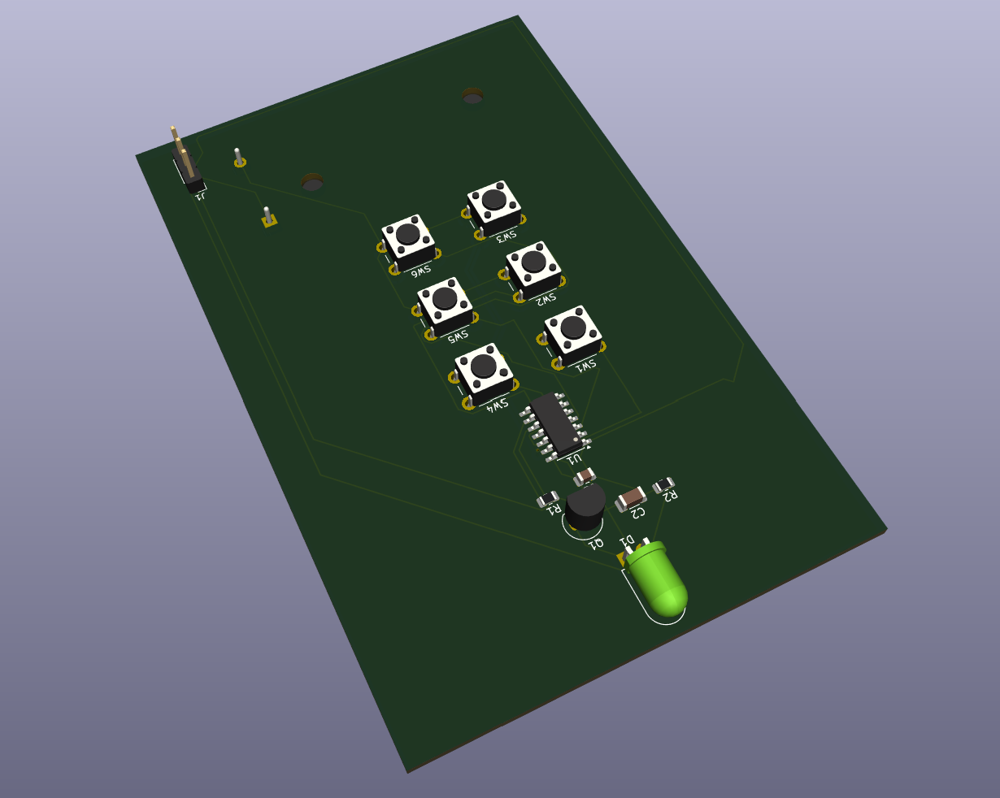
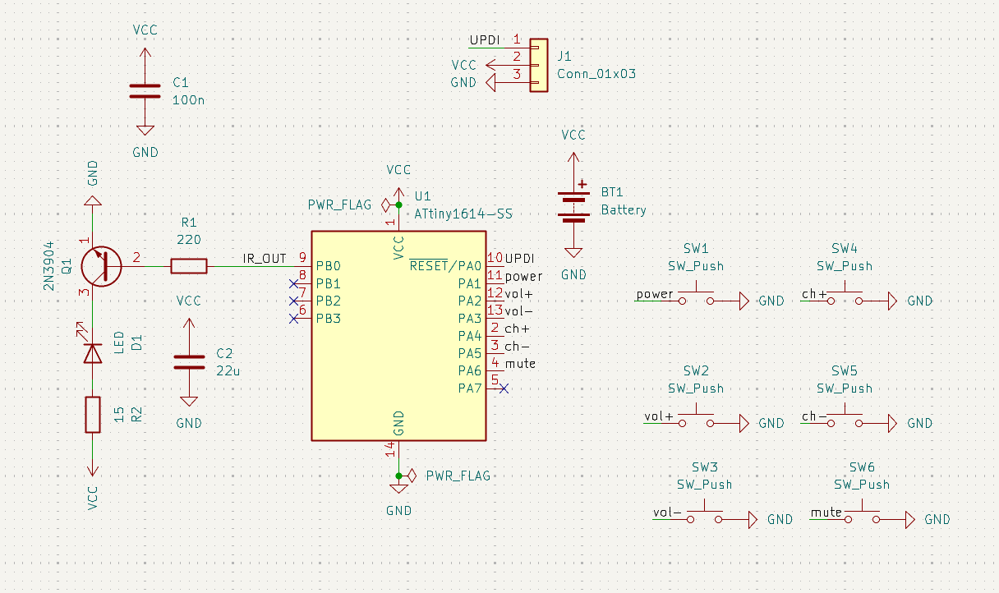
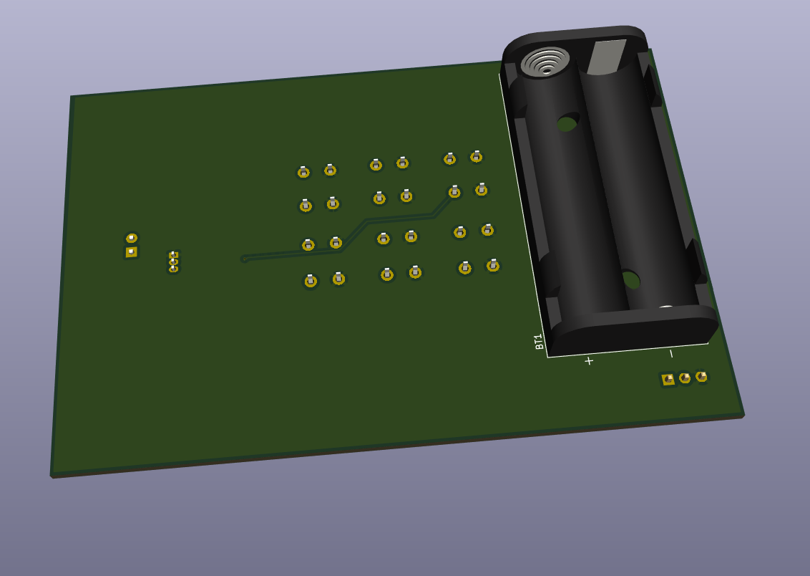

# Pilot IR na ATtiny1614

Pilot na podczerwień do telewizora, zaprojektowany od zera w KiCadzie: od policzenia wartości elementów, przez schemat, po samodzielnie poprowadzoną dwuwarstwową płytkę drukowaną. Zasilany z dwóch baterii AAA, ma sześć przycisków i diodę IR sterowaną przez tranzystor.

**Status:** projekt PCB ukończony (ERC, DRC i zgodność ze schematem bez błędów), firmware w przygotowaniu.



## Założenia projektu

**Pilot nadający.** Kody komend telewizora są zapisane w firmware, a naciśnięcie przycisku wysyła gotową komendę. Wariant „uczący się”, z odbiornikiem IR do nagrywania oryginalnego pilota, zostawiłem na wersję drugą. Tor nadawczy jest w obu wersjach identyczny, więc najpierw warto go opanować.

**Zasilanie z 2 × AAA, bez włącznika.** ATtiny1614 pracuje bezpośrednio z baterii (od 1,8 V), a w uśpieniu pobiera ułamek mikroampera, więc wyłącznik nie jest potrzebny. Mikrokontroler budzi naciśnięcie przycisku.

**Mikrokontroler dobrany pod baterie.** Rozważałem znany mi już ESP32-C3, ale potrzebuje on stabilizowanych 3,3 V (dwie baterie AAA dają 3 V i mniej) i pobiera znacznie więcej prądu. Wymagałby przetwornicy na płytce i szybciej rozładowywałby baterie. ATtiny upraszcza schemat kosztem nowego toolchainu: megaTinyCore w Arduino IDE i programowanie przez UPDI.

**Sześć przycisków:** zasilanie, głośność +/−, kanał +/− i wyciszenie.

**Nośna 38 kHz generowana sprzętowo** przez timer TCA0 na pinie PB0, więc jej przebieg nie zależy od tego, co w danej chwili robi program.

## Schemat



Schemat składa się z czterech bloków.

**Zasilanie.** Koszyk BT1 zasila sieć VCC, a kondensator C1 (100 nF) odsprzęga ATtiny.

**Przyciski.** Każdy zwiera swój pin do masy. Rezystory podciągające są wbudowane w ATtiny i włączane programowo, więc na płytce ich nie ma. Połączenia prowadzą etykiety sieci, dzięki czemu schemat pozostaje czytelny.

**Tor nadawczy.** Pin PB0 (etykieta `IR_OUT`) przez R1 steruje bazą tranzystora Q1, który przełącza obwód VCC → R2 → D1 → Q1 → GND. Kondensator C2 (22 µF) przy diodzie pokrywa impulsy prądu.

**Programowanie.** Złącze J1 wyprowadza UPDI (PA0), VCC i GND.

## Obliczenia

Wartości elementów toru nadawczego policzyłem sam, a potem dobrałem najbliższe wartości z typoszeregu.

**R2: ograniczenie prądu diody IR (cel: 100 mA)**

```
R2 = (U_bat − U_D − U_CE(sat)) / I_D
   = (3,0 V − 1,3 V − 0,3 V) / 0,1 A = 14 Ω   →   15 Ω  (I_D ≈ 93 mA)
```

Zaokrąglenie w górę: nieco mniejszy prąd, więc założenie nie zostaje przekroczone.

**R1: rezystor bazy Q1**

```
I_B ≈ I_C / 10 = 93 mA / 10 = 9,3 mA
R1  = (U_PB0 − U_BE) / I_B = (3,0 V − 0,8 V) / 9,3 mA ≈ 236,6 Ω   →   220 Ω  (I_B ≈ 10 mA)
```

Zaokrąglenie w dół: większy prąd bazy daje pewniejsze nasycenie tranzystora.

**C2: zbiornik na impulsy diody**

```
C = I · t / ΔV = 0,093 A · 9 µs / 0,1 V ≈ 8,4 µF   →   22 µF
```

t to czas jednego błysku przy nośnej 38 kHz, a ΔV to dopuszczalny spadek napięcia. Najbliższa wartość to 10 µF, ale ceramiczne kondensatory tracą pojemność pod napięciem i 10 µF przy 3 V realnie ma około 7 µF. Stąd 22 µF w obudowie 1206.

## Komponenty

| Oznaczenie | Element | Obudowa | Rola |
|---|---|---|---|
| U1 | ATtiny1614 | SOIC-14 | mikrokontroler |
| D1 | dioda IR 940 nm | 5 mm, montaż poziomy | nadajnik podczerwieni |
| Q1 | tranzystor NPN 2N3904 | TO-92 | przełącznik diody |
| R1 | rezystor 220 Ω | 0805 | rezystor bazy Q1 |
| R2 | rezystor 15 Ω | 0805 | ograniczenie prądu diody |
| C1 | kondensator ceramiczny 100 nF | 0805 | odsprzęganie U1 |
| C2 | kondensator ceramiczny 22 µF | 1206 | zbiornik na impulsy diody |
| SW1–SW6 | przycisk tact switch | 6 × 6 mm, THT | przyciski pilota |
| BT1 | koszyk 2 × AAA | Keystone 2468 | zasilanie, spód płytki |
| J1 | listwa goldpin 1 × 3 | raster 2,54 mm | programowanie UPDI |

## Przypisanie pinów

| Pin ATtiny1614 | Sieć | Funkcja |
|---|---|---|
| PA0 (10) | UPDI | programowanie |
| PA1 (11) | power | włącz / wyłącz |
| PA2 (12) | vol+ | głośniej |
| PA3 (13) | vol− | ciszej |
| PA4 (2) | ch+ | następny kanał |
| PA5 (3) | ch− | poprzedni kanał |
| PA6 (4) | mute | wyciszenie |
| PB0 (9) | IR_OUT | nośna 38 kHz do tranzystora |
| PA7, PB1–PB3 | – | niepodłączone |

## Płytka

Płytka jest dwuwarstwowa. Najważniejsze decyzje przy rozmieszczeniu:

- **Dioda IR przy górnej krawędzi**, w wersji poziomej, soczewką do przodu. Celuje w telewizor, a nie w sufit. Footprint trzyma ją 3 mm nad laminatem, więc krawędź płytki nie zasłania światła.
- **Tor nadawczy (C2, R2, D1, Q1) ciasno pod diodą.** Przez tę pętlę płyną impulsy 93 mA, więc im jest mniejsza, tym mniej zakłóceń. Ścieżki w tym torze mają szerokość 0,5 mm.
- **C1 tuż przy pinach zasilania U1** (piny 1 i 14).
- **Koszyk baterii na spodzie, poniżej przycisków**, a nie pod nimi. Nóżki przycisków THT wystają na spód i uchwyt by na nie naciskał.
- **Wylewka masy na całej warstwie B.Cu**, do której podłączone są wszystkie pola GND.

Weryfikacja: ERC bez błędów, DRC bez naruszeń i niepołączonych elementów, zgodność PCB ze schematem bez różnic.



*Zielona dioda na renderach to domyślny model 3D z biblioteki KiCada. Prawdziwa dioda IR jest przezroczysta, a jej światło widać dopiero w kamerze telefonu.*

## Czego się nauczyłem

**Liczenie zamiast przepisywania.** Wartości R1, R2 i C2 policzyłem sam z prawa Ohma i ze wzoru C = I·t/ΔV. Nauczyłem się też, że kierunek zaokrąglenia do typoszeregu zależy od tego, która strona jest bezpieczna: R2 w górę, R1 w dół, a C2 w górę z zapasem na utratę pojemności ceramiki pod napięciem.

**Tranzystor jako przełącznik.** Pin mikrokontrolera nie da prądu, jakiego dioda IR potrzebuje na dobry zasięg, więc steruje tranzystorem, który przełącza diodę. Prąd bazy równy około 1/10 prądu kolektora zapewnia pełne nasycenie.

**Dwa różne zadania kondensatorów.** 100 nF przy mikrokontrolerze tłumi krótkie szpilki prądu logiki cyfrowej, a 22 µF przy diodzie pokrywa jej impulsy. Na schemacie położenie kondensatora nie ma znaczenia, na płytce decyduje o tym, czy w ogóle spełnia swoje zadanie.

**Czytelny schemat.** Etykiety sieci zamiast plątaniny przewodów, flagi PWR_FLAG na sieciach zasilania i flagi „niepodłączony” na wolnych pinach, a na koniec ERC doprowadzony do zera.

**Rozmieszczenie przed trasowaniem.** Krzyżujące się linie połączeń to sygnał, żeby przestawić elementy, a nie kombinować ze ścieżkami. Zamiana stronami tranzystora i pary R2/C2 usunęła jedyne krzyżowanie w torze diody.

**Pierwsze samodzielne trasowanie.** Szersze ścieżki tam, gdzie płynie większy prąd, przelotki do zmiany warstwy (pola SMD istnieją tylko na wierzchu płytki), wylewka masy i DRC doprowadzony do zera razem z testem zgodności ze schematem.

**Mechanika to też część projektu.** Kierunek świecenia diody, właściwy rozmiar koszyka baterii (AA i AAA to zupełnie inne footprinty) i to, co wystaje na spód płytki, trzeba sprawdzić, zanim płytka trafi do produkcji.

## Dalsze kroki

- **Firmware:** Arduino IDE z megaTinyCore, wysyłanie kodów w protokole telewizora, uśpienie mikrokontrolera i budzenie przyciskiem.
- **Wersja 2:** odbiornik IR, czyli pilot uczący się, który nagrywa sygnał z oryginalnego pilota.
- **Produkcja:** porządki na sitodruku i zamówienie płytki.

## Pliki projektu

| Plik | Zawartość |
|---|---|
| `pilot.kicad_pro` | projekt KiCad |
| `pilot.kicad_sch` | schemat |
| `pilot.kicad_pcb` | płytka drukowana |
| `images/` | rendery 3D i schemat |

Projekt wykonany w KiCad 10.0.5.
